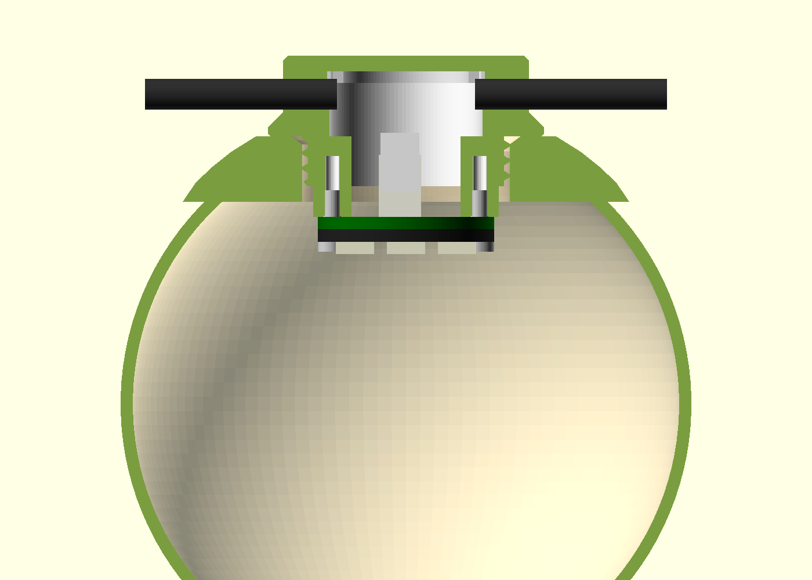

# Globe socket

String-light socket for the 75 mm solar-system lithophane globes
([MakerWorld 875391](https://makerworld.com/de/models/875391-solar-system-lithophane-planet-lamps-75mm),
mobile version). The globe hangs with its threaded opening up, the socket
screws into it, and the cable from globe to globe carries the weight.



## Parts

| File | Print | Hardware |
| --- | --- | --- |
| `stl/socket_body.stl` | upside down as exported (crown on the bed), no supports | 2x M2x8 for the LED stack |
| `stl/socket_cap.stl` | flat side down as exported, no supports | 2x M2x8 countersunk |

The thread is the author's generic-socket profile (right-hand, 2.0 mm pitch,
d 27.4 / 25.5). Checked against the globe mesh: 0.18 mm radial clearance at
the tightest point and about 0.5 mm axial play, the same fit as the original
socket. If it binds on your printer, raise `thread_clearance` (0.1 to 0.2).

## Assembly

1. Push the cable's PHD housing down through the socket bore and plug it onto
   J1 of the LED ring adapter below the socket.
2. Screw the ring and adapter to the two posts: M2x8 from the LED side, self
   tapping into the 1.75 mm holes. The screw head must stay under 4 mm
   diameter to clear the LEDs.
3. Lay the incoming cable into the -x channel and the outgoing cable into the
   +x channel, put the cap on, and fit 2x M2x8 countersunk. The cap tongues
   squeeze each jacket by 0.6 mm onto two grip ribs.
4. Screw the socket into the globe.

## Parameters

| Parameter | Default | Meaning |
| --- | --- | --- |
| `cable_d` | 4.0 | Outer diameter of the string cable; channels and cap follow it |
| `cable_squeeze` | 0.6 | Jacket compression under the cap |
| `led_drop` | 4.0 | Post length between plug and adapter; more puts the LEDs deeper |
| `mated_h` | 11.0 | Adapter top to top of the mated PHD housing |
| `wire_bend` | 5.0 | Housing top to cable axis |
| `thread_clearance` | 0.0 | Radial reduction of the socket thread |
| `hang_loop` | false | Eyelet on the cap for an extra safety thread |

Rebuild:

```bash
openscad --backend=manifold --export-format=binstl -D 'part="body"' -o stl/socket_body.stl globe_socket.scad
openscad --backend=manifold --export-format=binstl -D 'part="cap"' -o stl/socket_cap.stl globe_socket.scad
```

`part = "cutaway"`, `"assembly"` or `"exploded"` show the socket with the LED
stack, the PHD connector, the cables and the globe opening for checking.
